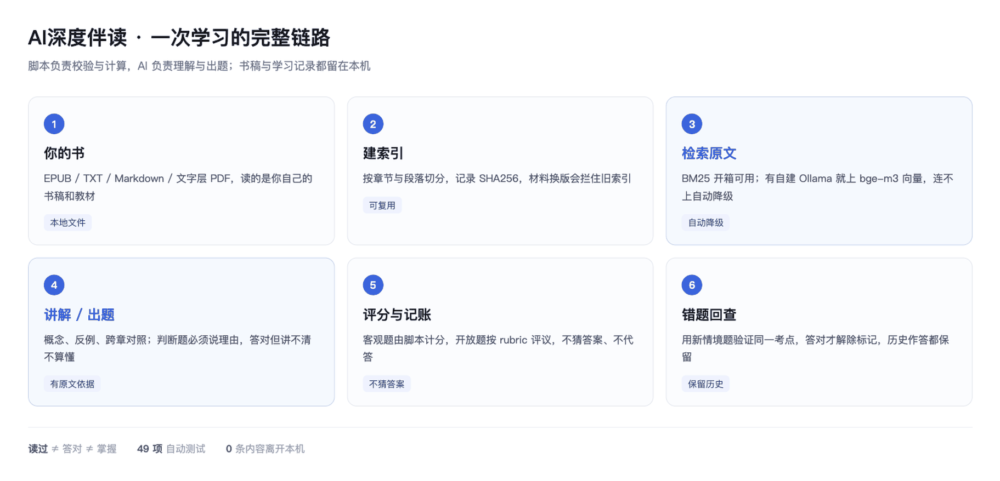

# AI深度伴读 · AI Companion Reading

**精读一本书，深学一门课，也能陪你把认证考试考下来。**

一个装在 AI Agent 里的读书与备考技能：读你本地的书稿和教材，拆概念、举反例、做跨章对照，再用判断题和开放题逼你把理解讲清楚——答对但说不出理由，只算「还需澄清」。



An Agent Skill for deep reading and exam prep on your **own** local books: EPUB / TXT / Markdown / text-layer PDF. Explains concepts with counter-examples, tests understanding with judgment + open questions, and tracks mistakes, weak points and review history — all stored locally.

---

## 30 秒跑通

不想先读书、只想看看它怎么工作？仓库里带了一本 1200 字的样例教材：

```bash
git clone https://github.com/henglu/ai-companion-reading.git
cd ai-companion-reading

# 1. 建索引（约 0.1 秒）
python3 scripts/index_book.py examples/sample-book.md /tmp/demo.db --title "有效反馈与检验理解"

# 2. 看章节结构
python3 scripts/read_book.py /tmp/demo.db --chapters

# 3. 按意思检索，不是关键词匹配
python3 scripts/search.py "为什么重复阅读感觉懂了却答不出来" /tmp/demo.db
```

输出里会给出章节、行号范围和原文片段——这就是 AI 后面出题和引用的依据。

---

## 为什么值得装

### ① 读透一本书，不是聊两句

拆概念、举反例、做跨章对照，把书里的框架落到你的实际问题上。章节读完可以自测：默认两道判断题 + 一道解释题 + 一道应用题。

- **判断题必须说理由**，猜对不算懂
- 开放题允许你不同意作者，只要论证站得住
- 答对但讲不清 → 判「还需澄清」，不给你虚假的成就感

### ② 备考认证，是真的按考试来

确认教材和考试范围后按章出题。客观题自动评分，错题连同教材依据一起记下。复习时用一道**新情境题**验证同一考点，答对才解除标记——不靠反复做原题假装掌握。

需要时组织自编模拟练习，官方材料与 AI 生成题分别标注；未答完、未评分、最终成绩三者分开记录，不把部分成绩说成总分。

作者（[@henglu](https://github.com/henglu)）用这套方法备考腾讯云 ADP-FDE 认证，考出 **96 分**。

### ③ 技术上的两个关键选择

**向量检索：换个说法也能命中**

本地装了 [Ollama](https://ollama.com) 就用 `bge-m3` 建向量，与 BM25 关键词检索做 RRF 融合。你问「这个模型为什么胡说八道」，它能找到原文里讲「幻觉」的那一段，不要求你背出书里的原词。

**装不了模型，就优雅降级**

没有 Ollama、模型没下、服务连不上——自动回到 BM25，并明确告诉你这次用的是哪种检索、尝试的端点在哪里。**装了更准，不装也能用，绝不假装向量已启用。**

端点可以指向局域网里另一台机器（比如放着 GPU 的工作站）：

```bash
AI_READING_OLLAMA=http://192.168.11.125:11434 \
  python3 scripts/build_vectors.py "/path/to/book.db" --model bge-m3
```

只接受本机、局域网与 Tailscale 网段，**公网端点直接拒绝**，书稿不外发。

### ④ 和微信读书类 Skill 的区别

| | 微信读书类 Skill | AI深度伴读 |
| --- | --- | --- |
| 读书范围 | 平台书库 | 你本地的 EPUB / TXT / MD / PDF，专业教材、内部讲义、课程文件都能读 |
| 交互重心 | 问答、摘录整理 | 检验理解：判断题要理由、开放题要论证 |
| 学习状态 | 基本无 | 进度 / 待澄清概念 / 错题 / 薄弱考点 / 复习历史，全存本地 |
| 备考能力 | 无 | 章节练习、客观题评分、错题回查、新题验证 |
| 可追溯 | 弱 | 引用定位到章节与段落，找不到就说找不到 |

---

## 它实际怎么回你（真实输出，可复现）

下面这段来自上面那本样例教材的实跑，不是编的对话：

```
你 ▸ 这一章读完了，出两道判断题，再给我一个解释题。

AI ▸ 判断题 1：只要把一本书重复读上几遍，就能确认自己已经理解。请判断并说明理由。
     判断题 2：把书里的结论迁移到新情境时，原结论依然成立。请判断并说明理由。
     开放题：为什么"合上书觉得都懂"是一件危险的事？请结合本章，并说一个你自己遇到过的例子。

你 ▸ 1 错。2 对，我觉得道理是通用的。

AI ▸ 题 1 判断正确，但你没有说明理由 → 记为「还需澄清」，
     追问：请说明判断理由，再评价概念是否理解。

     题 2 判断错误。原文：改变情境之后，原结论不一定适用。
     → 记为「迁移与条件边界」，待复习。

     开放题：部分理解。抓住了熟悉感与理解的差别，也给了个人例子，
     但没说清检验方式，也没区分「感觉懂」和「能讲清」的机制。
     （四维评分：概念 clear / 依据 clear / 推理 partial / 应用 clear）

你 ▸ 继续上次学习。

AI ▸ 待澄清概念 3 项：熟悉感与理解的差别 ×2、迁移与条件边界 ×1。
```

注意第 1 题：**答对了也给 partial**。这是这个技能和"刷题应用"最大的区别——它不奖励猜对。

---

## 安装

技能遵循通用 `SKILL.md` 规范，放进 Agent 的技能目录即可。

**方式一：克隆（推荐，便于 `git pull` 更新）**

```bash
git clone https://github.com/henglu/ai-companion-reading.git \
  ~/.workbuddy/skills/ai-companion-reading
```

**方式二：下载 ZIP**

到 [Releases](https://github.com/henglu/ai-companion-reading/releases/latest) 下载最新 zip，解压到 `~/.workbuddy/skills/ai-companion-reading/`。

**方式三：SkillHub**

在 [SkillHub](https://skillhub.cn/skills/user_13651ebd/ai-companion-reading-pub) 搜索「AI深度伴读」一键安装。

**依赖**：Python 3.10+。EPUB / TXT / Markdown / BM25 / 学习记录只用标准库；PDF 需要可选依赖：

```bash
python3 -m pip install "pypdf>=5,<7"
```

---

## 用法

**精读一本书**

> 陪我精读《卓有成效的管理者》，文件在 ~/Books/drucker.epub，这章读完用几个问题考考我。

**准备一项认证**

> 我要准备腾讯云 ADP-FDE 认证，这是教材和大纲，先陪我学第一章，学完出题，把我不熟的考点留下来复习。

**继续上次**

> 继续上次学习，先看看我还有哪些概念没理解清楚。

技能会区分「精读 / 伴读 / 这章读完考考我」（阅读模式）与「认证 / 考试 / 备考 / 模拟卷」（备考模式）；只想读书时不强制测试。

---

## 工作原理

| 组件 | 职责 |
| --- | --- |
| `scripts/index_book.py` | EPUB（按 OPF spine 顺序）/ TXT / Markdown / PDF 建索引，记录 SHA256 与章节、段落定位 |
| `scripts/check_environment.py` | 只读的依赖自检（含 PDF），不安装任何包、不联网 |
| `scripts/read_book.py` | 按章读取、分页（`next_offset`），避免「只读检索片段就宣称读完本章」 |
| `scripts/search.py` | BM25 + 可选向量，RRF 融合；输出 `requested_mode` 与 `actual_mode` |
| `scripts/build_vectors.py` | 调用自建 Ollama `/api/embed` 建向量，可指定端点 |
| `scripts/study.py` | 学习记录：进度、题目、作答、评分、错题、复习与解除标记 |
| `scripts/core.py` | 检索原语、端点策略、连接管理 |

**脚本负责校验与计算，AI 负责理解与出题。** 引文是否真实存在、客观题对错、跨考点解除标记是否合规，都由脚本强制校验；观点评价由宿主模型基于原文 rubric 作出。

学习记录默认保存在 `~/ai_reading/learning/learning.sqlite3`，只读你自己的书，不扫描其他笔记软件。

---

## 目录结构

```
.
├── SKILL.md                    # Agent 读取的主文件
├── README.md
├── LICENSE
├── assets/flow.png             # 链路示意图
├── examples/sample-book.md     # 1200 字样例教材，用于 30 秒试跑
├── references/
│   ├── reading-mode.md         # 阅读模式与章节自测规则
│   ├── exam-mode.md            # 备考、错题与复习规则
│   ├── retrieval.md            # 建库、检索、端点配置
│   ├── learning-state.md       # 学习记录与 JSON 格式
│   ├── examples.md             # 阅读与备考完整示例
│   ├── faq.md                  # 常见问题速查
│   ├── pdf-start.md            # PDF 依赖检查与安装引导
│   └── validation.md           # 故障恢复与发布前验证
├── scripts/
│   ├── core.py
│   ├── index_book.py
│   ├── check_environment.py
│   ├── read_book.py
│   ├── search.py
│   ├── build_vectors.py
│   └── study.py
├── tests/                      # 63 项自动测试
└── requirements.txt
```

---

## 质量与边界

- **63 项自动测试**（`tests/` 目录，可自行复跑）覆盖建库、检索、版本保护、评分、错题回查、端点策略与故障恢复
- 真实环境验证：21 MB EPUB → 26 章 / 223 段，0.2 秒建库；bge-m3 建 223×1024 向量约 10 秒
- 未验证 Windows；本机为 macOS，Python 3.13 实跑、3.10 语法兼容检查
- 扫描件需先 OCR；PDF 按物理页索引，不假装识别书中章节
- 索引与学习记录在本地，对话解释是否走云端取决于你的 Agent 配置

---

## License

[MIT](LICENSE) © 2026 Fey

---

## English TL;DR

A deep-reading + exam-prep Agent Skill for your **local** books. BM25 out of the box, optional `bge-m3` hybrid retrieval via a self-hosted Ollama (graceful fallback to BM25, and it always tells you which mode was actually used). Reading mode explains concepts with counter-examples and cross-chapter links; exam mode adds chapter drills, objective scoring, mistake review and same-concept retests. Index and learning records stay local; public embedding endpoints are refused.
